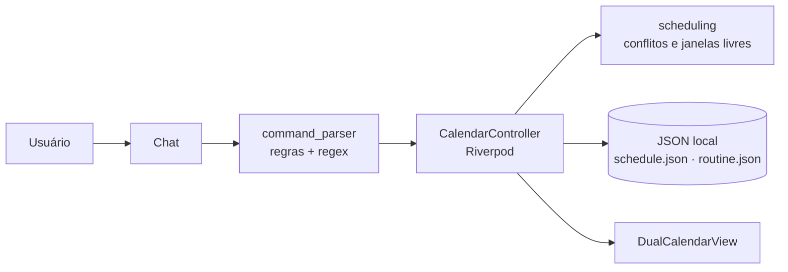

# Adaptive Routine

> Agenda para quem tem uma rotina fixa **e** imprevistos. Dois calendários e um chat de comandos que encaixa o imprevisto sem bagunçar a base.

<!-- Depois de gravar o GIF (veja docs/DEMO.md), descomente a linha abaixo:

-->

## O problema

Apps de agenda tratam tudo como um bloco igual e assumem uma rotina rígida. A vida de um estudante não é assim: há aulas fixas, mas também reunião de última hora, prova marcada de repente e estudo que precisa ser remarcado. Cada imprevisto vira retrabalho manual na semana inteira.

## A ideia: dois calendários

| | **Base fixa** (Camada 1) | **Dinâmico** (Camada 2) |
|---|---|---|
| O que é | Aulas, trabalho, compromissos que se repetem toda semana | Tarefas, estudos e eventos de última hora |
| Quem edita | **Só você**, na tela *Rotina fixa* | Você, pelo chat |
| Em caso de conflito | Nunca é movido | Pode ser remarcado, com a sua confirmação |

O chat nunca altera a base fixa. Se um evento novo bate com uma aula, o app oferece outras janelas para o **evento novo**.

## Como funciona

```text
Você: Tenho uma reunião de última hora hoje às 17h
App:  OK, adicionando "Reunião" ao calendário de atividades. Esse horário está ocupado
      com "Estudo de Física". Gostaria de dar prioridade para "Reunião" e encaixar
      "Estudo de Física" em outro horário durante a semana?
Você: sim
App:  Qual a data de preferência para encaixar "Estudo de Física"?   [opções sugeridas]
Você: amanhã 19h
App:  Feito. Reunião às 17:00; "Estudo de Física" → Seg 2/11 19:00.
```
*(texto levemente abreviado)* O calendário muda na tela enquanto você conversa. Se o horário estiver livre, o app confirma e avisa até quando ele segue livre.

## Isso é inteligência artificial?

**Não. Ainda não.** Esta é a parte que vale deixar clara:

- O chat interpreta o texto com **regras e expressões regulares** (`lib/features/chat/command_parser.dart`). Não há modelo de linguagem, API de IA nem chamada de rede no app.
- A decisão de conflitos e a busca de janelas livres são feitas por um **motor determinístico** (`lib/domain/scheduling.dart`), que roda local e é coberto por testes.
- Por isso o parser só entende os formatos listados abaixo. Frases fora desses padrões não são interpretadas.

**O que está planejado:** colocar um LLM atrás de uma interface, apenas para transformar frases livres em uma *intenção* estruturada. O princípio de design continua o mesmo: o modelo só interpreta, e o **motor decide**. Isso ainda **não está implementado**. Os detalhes estão em [`docs/ARCHITECTURE.md`](docs/ARCHITECTURE.md).

## O que o chat entende hoje

| Ação | Exemplos |
|---|---|
| Criar | `reunião hoje às 17h` · `Estudar ML hoje 8h as 9:30` · `dentista amanhã 14h por 2:30h` · `reunião quinta 15h` |
| Remarcar | `remarque academia de sexta para 15h` · `passa o Estudar ML para amanhã 10h` · `adiar reunião 30 min` |
| Aula cancelada (só aquele dia) | `aula de Lógica de quinta foi cancelada` · `restaurar Lógica quinta` |
| Remover | `remover Estudar ML de hoje` |
| Desfazer | `desfazer` (até 30 passos, enquanto o app está aberto) |
| Experimentar | `carregar exemplo` (só em agenda sem rotina cadastrada) |

Os testes em [`test/intent_test.dart`](test/intent_test.dart) e [`test/controller_test.dart`](test/controller_test.dart) documentam esses comportamentos.

## Estado do projeto

| ✅ Implementado | 🔜 Planejado |
|---|---|
| Calendário duplo com atualização em tempo real | Notificações e lembretes |
| Chat de comandos com negociação de conflito | Entrada por voz |
| Cadastro da rotina fixa e cancelamento de aula de um dia | Repetição pelo chat ("de segunda a sexta") |
| Remarcar, remover e desfazer | Reencaixe automático ao cadastrar uma aula nova |
| Salvamento local (JSON, escrita atômica) | LLM opcional para frases livres |
| Layout de celular: 3 dias, chat compacto embaixo, deslizar para navegar | |
| Testes do motor, do parser, da persistência, de conversas e de layout | |

**Limitações conhecidas**
- Testado apenas no **Windows**. O layout de celular existe e tem testes de widget, mas ainda não foi validado visualmente em aparelho; as pastas de Android, iOS, macOS e Linux existem, mas o app ainda não foi rodado nelas.
- Sem notificações e sem sincronização entre aparelhos.
- A rotina fixa é semanal; exceções são apenas cancelar ou remarcar um dia.

## Arquitetura



```text
lib/
├── domain/      # puro Dart: modelos, motor de conflitos, regras da rotina fixa
├── data/        # armazenamento local (arquivos JSON atrás de interfaces)
└── features/
    ├── calendar/  # controller (estado) e calendário duplo
    ├── chat/      # painel de chat e interpretador de comandos
    └── routine/   # tela de cadastro da rotina fixa
test/            # motor, parser, persistência e conversas ponta a ponta
```

Decisões que valem destacar:
- **Motor separado da interface:** `domain/` não depende de Flutter, então é testável sem abrir a janela.
- **Local-first:** tudo roda e é salvo no aparelho. Sem servidor.
- **Escrita atômica** dos arquivos (temporário + rename), com backup `.corrupt` se o arquivo estiver ilegível.
- **Testes de conversa** com `ProviderContainer`, que simulam diálogos completos e já pegaram um bug real de ids duplicados no Windows.

## Como rodar

Requisitos: [Flutter](https://docs.flutter.dev/get-started/install) 3.x. No Windows, o Visual Studio com a carga *Desktop development with C++* e o *Modo de Desenvolvedor* ligado (necessário para plugins).

```bash
git clone <url-do-repositório>
cd adaptive-routine
flutter pub get
flutter run -d windows
flutter test
```

Ao abrir, a agenda vem vazia. Digite `carregar exemplo` no chat, depois `Tenho uma reunião de última hora hoje às 17h`.

Os dados ficam no diretório de suporte do app (`schedule.json` e `routine.json`). O caminho é impresso no terminal ao iniciar.

## Documentação

- [`docs/PRODUCT.md`](docs/PRODUCT.md): problema, proposta de valor e personas.
- [`docs/ARCHITECTURE.md`](docs/ARCHITECTURE.md): decisões técnicas, modelo de dados, fluxo e roadmap com status. Os trechos sobre LLM descrevem o design-alvo, e estão marcados como planejados.
