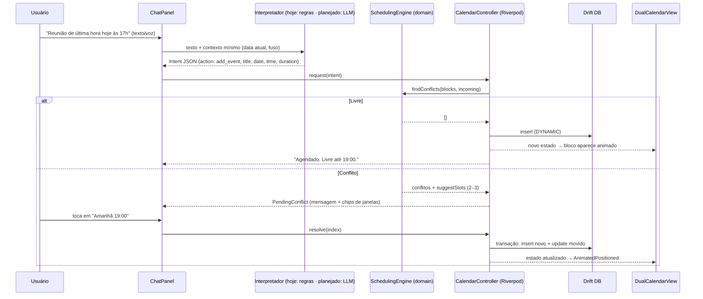

# ARCHITECTURE.md — Adaptive Routine

> **Estado atual (honesto):** a interpretação de comandos é feita por um **parser baseado em regras** (`lib/features/chat/command_parser.dart`). Não há LLM nem chamada de rede no app. Os trechos sobre LLM, `IntentService` e tool calling descrevem o **design-alvo planejado** e estão marcados como tal.

> Status: Fase 1 (Desktop + Android) · Versão do doc: 0.1

## 1. Decisão de stack

| Critério | Flutter | React Native + Tauri/Electron |
|---|---|---|
| Código compartilhado desktop+mobile | **~95%** (um só codebase, um só renderer) | ~70–80% (RN mobile + web/Tauri desktop = duas UIs) |
| Performance de UI | Renderer próprio (Impeller), 60/120 FPS consistentes | RN ok; Electron pesado em RAM; Tauri leve mas UI é WebView |
| Consumo de RAM desktop | Baixo (binário AOT) | Electron alto; Tauri baixo |
| Animações do calendário | Nativas, controle total | Dependem de libs/WebView |
| iOS na Fase 2 | Mesmo código | Mesmo código RN (mas desktop segue separado) |
| Notificações locais | `flutter_local_notifications` (todas as plataformas) | Duas implementações |

**Decisão: Flutter 3.x (Dart) para Windows, macOS, Linux e Android; iOS na Fase 2 sem reescrita.**
Motivo: o requisito "90%+ de código compartilhado com baixo consumo" é atendido com um único renderer, sem WebView.

### Stack detalhada
| Camada | Escolha | Observação |
|---|---|---|
| UI | Flutter + Material 3 customizado | Tokens em `DESIGN_SYSTEM.md` |
| Estado | **Riverpod 2** (Notifier) | Reativo, testável, sem boilerplate de Bloc; chat e calendário observam o mesmo estado |
| Banco local | **Drift (SQLite)** | Tipado, migrations, streams reativos. (Isar foi descartado: manutenção incerta) |
| Notificações | `flutter_local_notifications` + `timezone` | Agendamento local, ações interativas |
| Voz | `speech_to_text` (STT do SO) | On-device, sem custo |
| Interpretação de comandos | **Hoje:** parser por regras (`command_parser.dart`). **Planejado:** LLM via API com *tool calling* | O LLM entraria atrás de uma interface `IntentService` (ainda não criada) |
| Sync (pós-MVP) | Backend leve (ex.: Supabase/Postgres) com resolução por `updated_at` + `deleted_at` | Local-first: nuvem é réplica |

## 2. Princípio central (design-alvo): "o interpretador propõe, o motor decide"

```
LLM  →  entende linguagem natural, extrai INTENÇÃO (JSON)
Motor → calcula conflitos e janelas livres (código determinístico, offline)
UI   →  mostra preview; usuário confirma
Store → só então grava
```
O LLM **nunca** escreve direto no banco nem faz aritmética de horário.

## 3. Estrutura de diretórios

```
adaptive_routine/
├── docs/
├── lib/
│   ├── main.dart
│   ├── app/                    # tema, roteamento, layout responsivo
│   ├── core/                   # utils de data, formatação, erros
│   ├── domain/                 # PURO Dart, sem Flutter, 100% testável
│   │   ├── models.dart         # TimeBlock, Layer, Intent
│   │   └── scheduling.dart     # detecção de conflitos + janelas livres
│   ├── data/
│   │   ├── db/                 # Drift: tabelas, DAOs
│   │   └── repositories/       # BlockRepository (stream de blocos)
│   ├── services/
│   │   ├── intent_service.dart # interface; impl LLM e impl local/mock
│   │   ├── notification_service.dart
│   │   └── voice_service.dart
│   └── features/
│       ├── calendar/           # DualCalendarView + controller
│       ├── chat/               # ChatPanel + mensagens
│       └── settings/
├── test/                       # testes do domain (prioridade)
└── pubspec.yaml
```
Regra de dependência: `features → domain ← data`. `domain` não importa nada de Flutter.

## 4. Modelo de dados (Duplo Calendário)

```sql
CREATE TABLE blocks (
  id          TEXT PRIMARY KEY,           -- uuid v4
  title       TEXT NOT NULL,
  layer       INTEGER NOT NULL,           -- 0 = FIXED, 1 = DYNAMIC
  start_utc   INTEGER NOT NULL,           -- epoch ms
  end_utc     INTEGER NOT NULL,
  rule_id     TEXT REFERENCES recurrence_rules(id),  -- só FIXED
  kind        TEXT,                       -- class | work | study | meeting | task
  status      INTEGER NOT NULL DEFAULT 0, -- 0 planned | 1 done | 2 skipped
  origin      TEXT NOT NULL DEFAULT 'user', -- user | ai
  moved_from  INTEGER,                    -- start original (histórico de remanejamento)
  updated_at  INTEGER NOT NULL,
  deleted_at  INTEGER
);
CREATE INDEX idx_blocks_range ON blocks(start_utc, end_utc);

CREATE TABLE recurrence_rules (
  id TEXT PRIMARY KEY,
  rrule TEXT NOT NULL,                    -- RFC 5545, ex.: FREQ=WEEKLY;BYDAY=MO,WE
  until_utc INTEGER
);

CREATE TABLE reminders (
  id TEXT PRIMARY KEY,
  block_id TEXT NOT NULL REFERENCES blocks(id),
  offset_min INTEGER NOT NULL,            -- minutos antes do início
  fired_at INTEGER
);

CREATE TABLE preferences (key TEXT PRIMARY KEY, value TEXT);  -- horário ativo, silêncio, etc.
```
Ocorrências de blocos recorrentes são **expandidas em memória** para a janela visível (semana), não persistidas, o que mantém o banco pequeno.

**Invariantes (testados no domain):**
1. Bloco `FIXED` nunca é alterado por `origin = ai`.
2. `end > start`.
3. Remanejamento grava `moved_from`.

## 5. Fluxo Chat → Interpretador → Estado



### Contrato de intenção (tool calling)
```json
{
  "action": "add_event | move_event | cancel_event | query_free_time",
  "title": "Reunião",
  "date": "2026-10-31",
  "start_time": "17:00",
  "duration_min": 60,
  "target_ref": null,
  "confidence": 0.93
}
```
`confidence < 0.7` → o assistente pergunta antes de agir (planejado). Datas relativas ("amanhã") são resolvidas pelo LLM com a data atual enviada no prompt **e revalidadas** pelo app; o preview exibe a data resolvida em texto.

### Algoritmo de janelas livres (`suggestSlots`)
1. Para cada dia da semana, gerar intervalos livres dentro do horário ativo (padrão 08–22).
2. Manter os que comportam a duração; ignorar passado.
3. Rankear por proximidade do horário original; penalizar fragmentação (preferir encaixe colado a bloco existente) e horários fora de pico de energia do usuário (pós-MVP).
4. Retornar até 3 candidatos.

## 6. Notificações
- Agendadas localmente com `zonedSchedule` (funciona offline). Reagendadas a cada mutação de bloco via listener do repositório.
- Ações: *Ok*, *Adiar 10 min*, *Abrir*.
- Proativa de fim de dia (21:00 configurável): disparada se houve remanejamentos no dia ("Sua rotina de amanhã foi ajustada. Quer revisar?").
- Desktop: central de ações do SO; manter app na bandeja (`tray_manager`) para disparar com a janela fechada. Android: canal de alta prioridade + `exactAlarm` com fallback.

## 7. Performance (metas e táticas)
- Janela de renderização = 1 semana; blocos expandidos só para ela.
- `RepaintBoundary` por coluna de dia; `const` widgets; listas com `ListView.builder`.
- `ref.watch(...select(...))` para evitar rebuilds amplos.
- Animações via `AnimatedPositioned` (implícitas, GPU).
- Sem chamada de rede no caminho crítico de abertura; STT e LLM só sob demanda.
- Orçamento: cold start < 1,5 s desktop, idle RAM < 150 MB desktop.

## 8. Privacidade e segurança
- Dados locais criptografáveis (SQLCipher opcional).
- Ao LLM envia-se apenas o texto do usuário + data/fuso; para sugerir janelas, o cálculo é local (nenhum dado da agenda sai).
- Chave de API nunca no cliente: chamadas passam por um proxy leve (Edge Function) com rate limit.

## 9. Roadmap técnico (Fase 1) — com status

| Marco | Entrega | Status |
|---|---|---|
| M0 | Boilerplate + calendário duplo com estado dinâmico | ✅ feito |
| M1 | Persistência local (arquivo JSON atrás de `BlockRepository`; Drift fica para quando houver sync) + testes do motor | ✅ feito |
| M2 | Interpretador com LLM (tool calling) + preview de confirmação | 🔜 planejado |
| M3 | Notificações locais + voz | 🔜 planejado |
| M4 | Cadastro da rotina fixa (regras semanais, cancelar aula de um dia). RRULE completo não incluído | ✅ feito |
| M5 | Polimento e empacotamento (Windows/Android; iOS na Fase 2) | 🔜 planejado |
| — | Layout de celular, remarcar, desfazer | ✅ feito (layout de celular ainda sem validação visual em aparelho) |

## 10. Documentos a produzir na sequência
`DESIGN_SYSTEM.md` (tokens, estados Fixo vs Dinâmico, responsivo) e `UX.md` (diagrama do fluxo de conflito).

## 11. Decisão registrada no M1 (persistência)

- A camada **dinâmica** é salva em `schedule.json` (diretório de suporte do app), com escrita atômica (arquivo temporário + rename) e fila de gravações.
- O acesso passa por `BlockRepository` (`lib/data/block_repository.dart`). A troca por **Drift/SQLite** é prevista quando houver recorrência real (M4) e sync, sem mudar controller nem UI.
- A **base fixa** ainda é de demonstração: gerada por regras semanais em código (4 semanas atrás, 26 à frente). O cadastro real e a persistência dela entram no M4.
- Arquivo ilegível é renomeado para `schedule.json.corrupt` em vez de sobrescrito.

## 12. Decisão registrada no M4 (rotina fixa real)

- A base fixa deixa de ser demonstração: o usuário cadastra **regras semanais** (`FixedRule`: nome, dias, início, fim) na tela `Rotina fixa`. É a única forma de editar a Camada 1; a IA nunca altera esses blocos.
- As regras ficam em `routine.json` (mesmo padrão do `schedule.json`: escrita atômica, backup `.corrupt`), atrás de `RuleRepository`.
- Os blocos fixos são **expandidos em memória** (4 semanas atrás, 26 à frente) a partir das regras; só as regras são persistidas.
- A grade do calendário cresce além de 08–22h quando há blocos fora dessa faixa. As sugestões de janela continuam usando 08–22h como horário ativo.
- Ao salvar ou remover uma regra, o app avisa no chat se atividades dinâmicas futuras passaram a colidir com a rotina fixa. O reencaixe automático fica para a edição direta/comando "mover".

## 13. Aula cancelada (exceção pontual)

- `FixedRule.skipDates` guarda datas (`yyyy-MM-dd`) em que a aula não acontece. A regra segue valendo nas outras semanas; só aquela ocorrência deixa de ser gerada.
- O usuário informa pelo chat ("aula de Lóg. Prog. de quinta foi cancelada"); o app cancela apenas a ocorrência e avisa como desfazer ("restaurar Lóg. Prog. quinta"). A regra em si só muda na tela Rotina fixa.
- Compatível com arquivos antigos: `routine.json` sem o campo `skip` carrega normalmente.

## 14. Remarcar e desfazer

- **Remarcar** ("remarque academia de sexta para 15h", "passa o Estudar ML para amanhã 10h", "adiar reunião 30 min"): o parser separa *origem* (qual evento) de *destino* (novo dia/hora) pelo último "para/pra" que tenha dia ou hora depois.
- A remarcação **reusa a negociação de conflito**: `request(incoming, replaceId: ...)`. O bloco antigo só some quando o novo horário é confirmado; cancelar a conversa deixa tudo como estava.
- **Evento dinâmico:** muda de horário mantendo o mesmo id. **Aula fixa de um dia:** a data vira `skipDates` da regra e nasce uma atividade dinâmica com o mesmo nome e duração; a regra não muda.
- **Desfazer** ("desfazer"): pilha em memória (até 30) de `(blocks, rules)` alimentada automaticamente por `listenSelf` a cada mudança. Não é persistida: fechar o app limpa o histórico.
- Verbos ambíguos ("passar", "mudar", "trocar") só viram remarcação quando acompanhados de "para/pra"; "passar na farmácia hoje 17h" continua sendo criar evento.

## 15. Layout responsivo (celular)

- Larguras abaixo de 900 px usam o layout de celular: calendário em cima e `ChatDock` embaixo (última resposta do app, botões de resposta rápida e campo de texto). Tocar na resposta abre o histórico completo numa folha.
- Dentro do calendário, abaixo de 640 px são mostrados **3 dias** a partir de `focusDay`; setas e deslizar para o lado andam de 3 em 3. Acima disso, a semana de 7 dias de sempre.
- `weekStart` (segunda-feira da semana que contém `focusDay`) continua sendo a referência para "quinta", "sexta" etc. nos comandos.
- Coberto por testes de widget em tamanhos de celular e de desktop (`test/layout_test.dart`). **Validação visual em janela estreita e em aparelho real ainda pendente.**

## 16. Situação dos blocos e menu ao tocar

- `BlockStatus { planned, done, missed }`. Em blocos **dinâmicos** a situação é um campo do bloco (`schedule.json`). Em blocos da **rotina fixa** é guardada por data dentro da regra (`FixedRule.statuses`, em `routine.json`), pois a regra gera um bloco por semana.
- Arquivos antigos sem esses campos carregam normalmente (padrão: pendente).
- Cores em `block_style.dart`: pendente cinza/roxo; realizada verde e não realizada vermelho, com tons **suaves** na base fixa e **vivos** no dinâmico. Um ícone acompanha a cor.
- O menu (`block_sheet.dart`) chama o `CalendarController` (`setStatus`, `moveBlock`, `removeBlock`, `cancelOccurrence`). `moveBlock` usa o mesmo caminho do comando de chat (`request(..., replaceId:)`), então a negociação de conflito e o desfazer funcionam igual.
- Remarcar volta a situação para pendente. O app passou a usar a localização `pt_BR` (`flutter_localizations`) para os seletores de data e hora.

## 17. Reencaixe, uma atividade por vez

- Gatilhos: (a) uma regra da rotina fixa nova ou editada, ou uma aula restaurada, passa a colidir com atividades dinâmicas futuras; (b) uma atividade **dinâmica** é marcada como não realizada. Aula da rotina fixa não realizada não gera reencaixe.
- Cada item reusa a negociação já existente: um `PendingConflict` no estágio de preferência, com `replaces` apontando para o bloco que vai mudar de lugar e `reflowQueue` com os próximos. As janelas vêm de `suggestSlots` (até 3), sem repetir o horário atual.
- O usuário escolhe uma janela, escreve outro dia/horário ou mantém ("Manter onde está" / "Deixar assim"); em seguida o app passa para o próximo da fila. Nada é movido sem confirmação, e o "desfazer" cobre cada passo.
- Um bloco reencaixado volta para pendente.

## 18. Feriados e eventos

- `Holiday { name, kind, hidesFixed, exceptions }` (`kind`: `holiday` ou `event`; arquivos antigos sem o campo são feriado), guardado por data (`yyyy-MM-dd`) em `holidays.json` (`HolidayRepository`, mesmo padrão dos outros arquivos: escrita atômica e backup `.corrupt`).
- A escolha é **por compromisso**: `hidesFixed` é a regra geral do dia e `exceptions` lista os ids de regras que fazem o contrário. `Holiday.hides(ruleId)` responde se aquele compromisso não acontece. Um compromisso cadastrado depois segue a regra geral. Arquivos antigos (só `hidesFixed`) continuam válidos.
- Na tela, cada compromisso tem um interruptor. Ao salvar, a regra geral é a que a maioria das escolhas indica (empate: "não acontece") e as exceções são os que divergem.
- A escolha fica **no dia especial**, não como aula cancelada: `expandRules` pula os blocos escondidos. Assim, desmarcar o dia devolve os compromissos sem mexer em `skipDates`.
- O "desfazer" guarda também os feriados em cada passo.
- Atividades dinâmicas não são afetadas, e o reencaixe não conta compromissos escondidos.
- Interface: tocar no nome do dia (`_DayHeader`) abre `HolidayDialog`. A coluna ganha o tom de `dayKindTint` (âmbar para feriado, azul-céu para evento) e o nome aparece no cabeçalho com `dayKindAccent`. Num dia novo, feriado começa com nenhum compromisso acontecendo e evento com todos (até o usuário mexer nos interruptores).

## 19. Início da semana

- A semana exibida começa no **domingo** (Dom ... Sáb), como nos calendários usados no Brasil. A regra fica em um só lugar, `lib/domain/week.dart` (`kWeekStart`); para voltar a Seg ... Dom basta trocar a constante para `DateTime.monday`.
- Nada mais assume uma semana começando na segunda: `expandRules` e o interpretador de comandos calculam a posição de cada dia da semana a partir do início de semana recebido, e os botões de dia da tela Rotina fixa seguem a mesma ordem.

## 20. App web (PWA) e plano de sincronização

**Fase 1, feita: app web instalável.**
- No navegador não há arquivos em disco. Com `kIsWeb`, o app usa `PrefsBlockRepository`, `PrefsRuleRepository` e `PrefsHolidayRepository` (`prefs_repositories.dart`), sobre `SharedPreferences` (localStorage). O **formato JSON é o mesmo** dos arquivos: os codecs (`encodeBlocks`/`decodeBlocks` etc.) são compartilhados, e dado ilegível vira uma cópia `.corrupt`.
- `web/` traz `index.html` (metas de iPhone para abrir em tela cheia), `manifest.json`, ícones (inclusive `apple-touch-icon`) e `_headers` (sem cache para `index.html`, service worker e manifesto, para as atualizações chegarem). Publicação: `docs/DEPLOY.md`.
- O app instalado na tela inicial do iPhone e o Safari têm armazenamento separado; por isso, o uso deve ser sempre pelo ícone.

**Fase 2, planejada: sincronização (Supabase).**
- Cada aparelho continua com a sua cópia local (funciona offline). A nuvem é a cópia compartilhada, com login por e-mail e a mesma conta em todos os aparelhos.
- Tabelas `blocks`, `rules` e `holidays`: `user_id`, `id` (ou data, nos feriados), `data jsonb`, `updated_at`, `deleted` (marca de exclusão). Regras de acesso por linha (RLS): `user_id = auth.uid()`.
- Sincronização por item, com a edição mais recente vencendo: envia o que mudou, baixa o que mudou desde o último ponto, ao abrir, ao voltar para o app e após cada mudança. Precisa de `updatedAt` em blocos, regras e feriados, e de uma marca de exclusão em vez de remover.
- Mudanças vindas da nuvem não entram na pilha de "desfazer" e não disparam novo envio.
- Riscos conhecidos: o plano grátis pode pausar o projeto por inatividade; as chaves públicas ficam no app, então a segurança depende das regras de acesso por linha.
