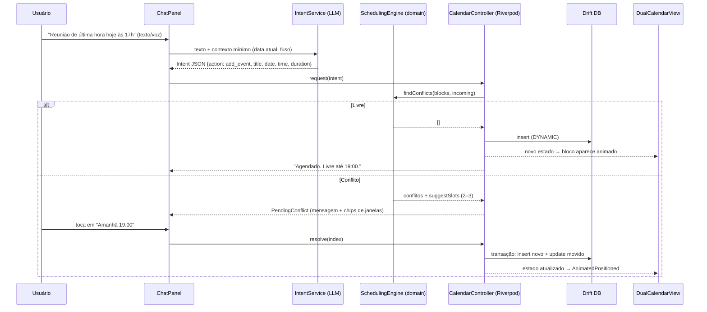

# ARCHITECTURE.md — Adaptive Routine AI

> Status: Fase 1 (Desktop + Android) · Versão do doc: 0.1

## 1. Decisão de stack

| Critério | Flutter | React Native + Tauri/Electron |
|---|---|---|
| Código compartilhado desktop+mobile | **~95%** (um só codebase, um só renderer) | ~70–80% (RN mobile + web/Tauri desktop = duas UIs) |
| Performance de UI | Renderer próprio (Impeller), 60/120 FPS consistentes | RN ok; Electron pesado em RAM; Tauri leve mas UI é WebView |
| Consumo de RAM desktop | Baixo (binário AOT) | Electron alto; Tauri baixo |
| Animações do calendário | Nativas, controle total | Dependem de libs/WebView |
| iOS na Fase 2 | Mesmo código | Mesmo código RN (mas desktop segue separado) |
| Notificações locais | `flutter_local_notifications` (todas as plataformas) | Duas implementações |

**Decisão: Flutter 3.x (Dart) para Windows, macOS, Linux e Android; iOS na Fase 2 sem reescrita.**
Motivo: o requisito "90%+ de código compartilhado com baixo consumo" é atendido com um único renderer, sem WebView.

### Stack detalhada
| Camada | Escolha | Observação |
|---|---|---|
| UI | Flutter + Material 3 customizado | Tokens em `DESIGN_SYSTEM.md` |
| Estado | **Riverpod 2** (Notifier) | Reativo, testável, sem boilerplate de Bloc; chat e calendário observam o mesmo estado |
| Banco local | **Drift (SQLite)** | Tipado, migrations, streams reativos. (Isar foi descartado: manutenção incerta) |
| Notificações | `flutter_local_notifications` + `timezone` | Agendamento local, ações interativas |
| Voz | `speech_to_text` (STT do SO) | On-device, sem custo |
| IA | Provedor LLM via API (Claude) com *tool calling* | Atrás de interface `IntentService` (trocável/offline) |
| Sync (pós-MVP) | Backend leve (ex.: Supabase/Postgres) com resolução por `updated_at` + `deleted_at` | Local-first: nuvem é réplica |

## 2. Princípio central: "LLM propõe, motor decide"

```
LLM  →  entende linguagem natural, extrai INTENÇÃO (JSON)
Motor → calcula conflitos e janelas livres (código determinístico, offline)
UI   →  mostra preview; usuário confirma
Store → só então grava
```
O LLM **nunca** escreve direto no banco nem faz aritmética de horário.

## 3. Estrutura de diretórios

```
adaptive_routine/
├── docs/
├── lib/
│   ├── main.dart
│   ├── app/                    # tema, roteamento, layout responsivo
│   ├── core/                   # utils de data, formatação, erros
│   ├── domain/                 # PURO Dart, sem Flutter, 100% testável
│   │   ├── models.dart         # TimeBlock, Layer, Intent
│   │   └── scheduling.dart     # detecção de conflitos + janelas livres
│   ├── data/
│   │   ├── db/                 # Drift: tabelas, DAOs
│   │   └── repositories/       # BlockRepository (stream de blocos)
│   ├── services/
│   │   ├── intent_service.dart # interface; impl LLM e impl local/mock
│   │   ├── notification_service.dart
│   │   └── voice_service.dart
│   └── features/
│       ├── calendar/           # DualCalendarView + controller
│       ├── chat/               # ChatPanel + mensagens
│       └── settings/
├── test/                       # testes do domain (prioridade)
└── pubspec.yaml
```
Regra de dependência: `features → domain ← data`. `domain` não importa nada de Flutter.

## 4. Modelo de dados (Duplo Calendário)

```sql
CREATE TABLE blocks (
  id          TEXT PRIMARY KEY,           -- uuid v4
  title       TEXT NOT NULL,
  layer       INTEGER NOT NULL,           -- 0 = FIXED, 1 = DYNAMIC
  start_utc   INTEGER NOT NULL,           -- epoch ms
  end_utc     INTEGER NOT NULL,
  rule_id     TEXT REFERENCES recurrence_rules(id),  -- só FIXED
  kind        TEXT,                       -- class | work | study | meeting | task
  status      INTEGER NOT NULL DEFAULT 0, -- 0 planned | 1 done | 2 skipped
  origin      TEXT NOT NULL DEFAULT 'user', -- user | ai
  moved_from  INTEGER,                    -- start original (histórico de remanejamento)
  updated_at  INTEGER NOT NULL,
  deleted_at  INTEGER
);
CREATE INDEX idx_blocks_range ON blocks(start_utc, end_utc);

CREATE TABLE recurrence_rules (
  id TEXT PRIMARY KEY,
  rrule TEXT NOT NULL,                    -- RFC 5545, ex.: FREQ=WEEKLY;BYDAY=MO,WE
  until_utc INTEGER
);

CREATE TABLE reminders (
  id TEXT PRIMARY KEY,
  block_id TEXT NOT NULL REFERENCES blocks(id),
  offset_min INTEGER NOT NULL,            -- minutos antes do início
  fired_at INTEGER
);

CREATE TABLE preferences (key TEXT PRIMARY KEY, value TEXT);  -- horário ativo, silêncio, etc.
```
Ocorrências de blocos recorrentes são **expandidas em memória** para a janela visível (semana), não persistidas, o que mantém o banco pequeno.

**Invariantes (testados no domain):**
1. Bloco `FIXED` nunca é alterado por `origin = ai`.
2. `end > start`.
3. Remanejamento grava `moved_from`.

## 5. Fluxo Chat → IA → Estado



### Contrato de intenção (tool calling)
```json
{
  "action": "add_event | move_event | cancel_event | query_free_time",
  "title": "Reunião",
  "date": "2026-10-31",
  "start_time": "17:00",
  "duration_min": 60,
  "target_ref": null,
  "confidence": 0.93
}
```
`confidence < 0.7` → a IA pergunta antes de agir. Datas relativas ("amanhã") são resolvidas pelo LLM com a data atual enviada no prompt **e revalidadas** pelo app; o preview exibe a data resolvida em texto.

### Algoritmo de janelas livres (`suggestSlots`)
1. Para cada dia da semana, gerar intervalos livres dentro do horário ativo (padrão 08–22).
2. Manter os que comportam a duração; ignorar passado.
3. Rankear por proximidade do horário original; penalizar fragmentação (preferir encaixe colado a bloco existente) e horários fora de pico de energia do usuário (pós-MVP).
4. Retornar até 3 candidatos.

## 6. Notificações
- Agendadas localmente com `zonedSchedule` (funciona offline). Reagendadas a cada mutação de bloco via listener do repositório.
- Ações: *Ok*, *Adiar 10 min*, *Abrir*.
- Proativa de fim de dia (21:00 configurável): disparada se houve remanejamentos no dia ("Sua rotina de amanhã foi ajustada. Quer revisar?").
- Desktop: central de ações do SO; manter app na bandeja (`tray_manager`) para disparar com a janela fechada. Android: canal de alta prioridade + `exactAlarm` com fallback.

## 7. Performance (metas e táticas)
- Janela de renderização = 1 semana; blocos expandidos só para ela.
- `RepaintBoundary` por coluna de dia; `const` widgets; listas com `ListView.builder`.
- `ref.watch(...select(...))` para evitar rebuilds amplos.
- Animações via `AnimatedPositioned` (implícitas, GPU).
- Sem chamada de rede no caminho crítico de abertura; STT e LLM só sob demanda.
- Orçamento: cold start < 1,5 s desktop, idle RAM < 150 MB desktop.

## 8. Privacidade e segurança
- Dados locais criptografáveis (SQLCipher opcional).
- Ao LLM envia-se apenas o texto do usuário + data/fuso; para sugerir janelas, o cálculo é local (nenhum dado da agenda sai).
- Chave de API nunca no cliente: chamadas passam por um proxy leve (Edge Function) com rate limit.

## 9. Roadmap técnico (Fase 1)
| Marco | Entrega |
|---|---|
| M0 | Boilerplate + Calendário Duplo com estado dinâmico (**este commit**) |
| M1 | Persistência Drift + testes do motor de conflitos |
| M2 | IntentService real (LLM, tool calling) + preview de confirmação |
| M3 | Notificações locais + voz |
| M4 | Recorrência (RRULE) + onboarding da Base Fixa |
| M5 | Polimento, empacotamento Win/macOS/Linux/APK |

## 10. Documentos a produzir na sequência
`DESIGN_SYSTEM.md` (tokens, estados Fixo vs Dinâmico, responsivo) e `UX.md` (diagrama do fluxo de conflito).
